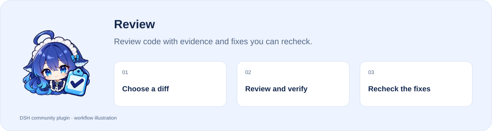

[简体中文](README.md) · **English**

# Review

> **Evidence-backed code review with verifiable fixes and repeatable quality gates.**

Code review plugin for DeepSeek Harness (`>=0.2.2-rc.3`) combining fresh-context defect discovery, independent verifier voting, risk tiers, and incremental convergence across quick, standard, and deep gates.

[](https://www.npmjs.com/package/@stardustlc/dsh-review) [](https://www.npmjs.com/package/@stardustlc/dsh-review) [](https://www.npmjs.com/package/@stardustlc/dsh-review)

**[Features](#features) · [Install](#install) · [Workflow](#start-using-it) · [Full guide](https://github.com/STARDUSTLC666/dsh-review/blob/main/docs/REFERENCE.en.md)**

<picture>
  <source media="(prefers-color-scheme: dark) and (max-width: 640px)" srcset="https://raw.githubusercontent.com/STARDUSTLC666/dsh-review/main/docs/assets/intro/workflow-en-mobile-dark.svg">
  <source media="(max-width: 640px)" srcset="https://raw.githubusercontent.com/STARDUSTLC666/dsh-review/main/docs/assets/intro/workflow-en-mobile-light.svg">
  <source media="(prefers-color-scheme: dark)" srcset="https://raw.githubusercontent.com/STARDUSTLC666/dsh-review/main/docs/assets/intro/workflow-en-dark.svg">
  
</picture>

## Features

| Pillar | Capabilities |
| :--- | :--- |
| **Flexible Scope & Depth** | Review working tree, staged diff, or Git base across **quick / standard / deep** review gates |
| **Fresh-Context Verification** | Independent finders and verifier voting filter stylistic noise and surface file/line triggers with concrete evidence |
| **Incremental Gate Tracking** | Track open fixes or recorded waivers and rerun the gate after edits, preserving host permissions and cancellation controls |

## Install

Open **Plugins** in the DSH desktop app and install `@stardustlc/dsh-review`, or use the CLI:

```bash
dsh plugin --profile desktop add @stardustlc/dsh-review
```

For the web profile, replace `desktop` with `web` and restart DSH. Requires DSH `>=0.2.2-rc.3` (standalone companion plugin, not bundled in `dsh-suite`).

## Start using it

1. **Pick scope & depth**: State whether to review working tree, staged changes, or branch diff against `main` (quick / standard / deep).
2. **Inspect verified findings**: Review severity-sorted issues backed by file/line locations, failure triggers, and proof.
3. **Fix or waive cleanly**: Patch confirmed bugs in chat, or record rationale for intentional behavior.
4. **Re-verify the gate**: Rerun the review gate after code edits before running CI and opening a PR.

### Ready-to-copy prompts

- **Pre-PR self-check**: `Review my current branch diff against main with concrete triggers and code evidence — don't edit files yet.`
- **High-risk deep audit**: `Run a deep review on the staged auth and concurrency changes, focusing on race conditions, permissions, and rollback safety.`
- **Fix & recheck gate**: `Fix the confirmed high-severity findings, then re-run the review gate to confirm nothing remains open.`

## Before you start

- AI reviews and gates complement — rather than replace — real tests, CI, and human review.
- Evidence checks follow the active native or PTC executor and honor host permission/cancellation controls; refused or incomplete runs never pass.
- Full configuration, tools, and troubleshooting: [full reference](https://github.com/STARDUSTLC666/dsh-review/blob/main/docs/REFERENCE.en.md).

## Plugin updates

Check updates at the bottom of native plugin details. Automatic checks are on by default; **automatic installation is off**.

## Documentation & feedback

- [Full usage, configuration and limits](https://github.com/STARDUSTLC666/dsh-review/blob/main/docs/REFERENCE.en.md) · [Release notes](https://github.com/STARDUSTLC666/dsh-review/blob/main/CHANGELOG.md) · [Validation history](https://github.com/STARDUSTLC666/dsh-review/blob/main/docs/VALIDATION.md)
- Stars, [Issues](https://github.com/STARDUSTLC666/dsh-review/issues), and [PRs](https://github.com/STARDUSTLC666/dsh-review/pulls) are welcome (strip credentials first).

## License

[MIT](https://github.com/STARDUSTLC666/dsh-review/blob/main/LICENSE)
